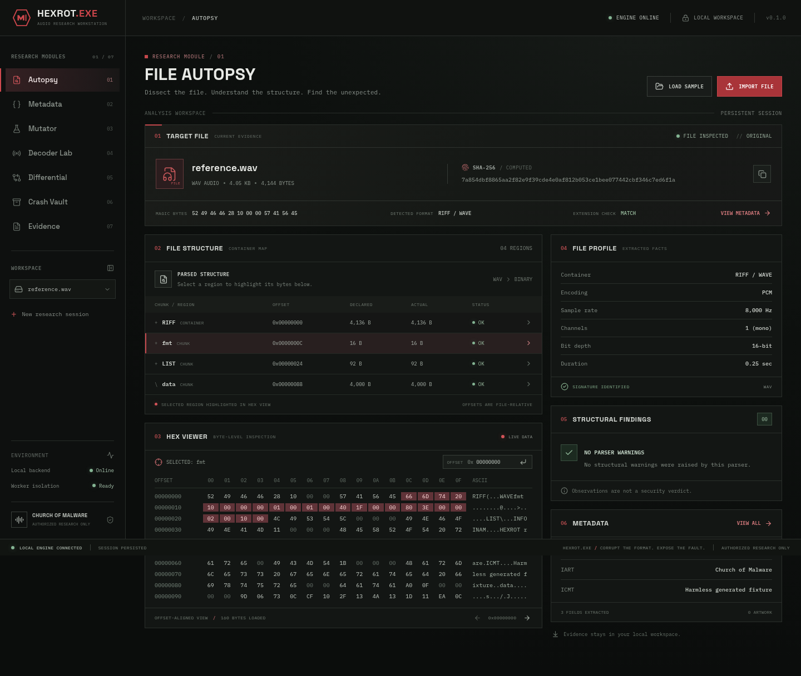

# HEXROT.EXE

**Corrupt the Format. Expose the Fault.**

HEXROT.EXE is a local-first audio-format research workstation. It reads actual files, records their binary structure and metadata, generates deterministic malformed variants, and compares real decoder process outcomes. It does not identify confirmed vulnerabilities, execute embedded content, generate exploit payloads, or send files to a cloud service.



This is a research prototype, not a hardened malware-analysis appliance. The browser-only preview can inspect a limited subset of a file, but mutation files, persistence, decoder execution, and evidence exports require the local backend. The original build recorded a complete workflow on Linux x86_64; the revised build has not repeated that Linux decoder integration run. The Apple Silicon/macOS configuration below is implemented but has **not** been verified on a Mac in this build; `sandbox-exec` is deprecated by Apple and may be unavailable or require profile adjustments on a particular macOS release. Decoder execution remains disabled if the sandbox self-test fails.

## Capabilities

- Parse RIFF/WAVE, AIFF/AIFC, FLAC metadata blocks, and MP3/ID3 structures; calculate SHA-256, inspect exact byte ranges, report declared versus available lengths, and flag known structural irregularities.
- Extract RIFF INFO and AIFF text directly, and use Mutagen for supported ID3, Vorbis comments, artwork fingerprints, and audio properties. Heuristics are labeled separately from extracted facts.
- Generate up to 50 variants per request using a seed, selectable strategies, selected byte regions, a file-size limit, and a metadata-value limit. Changes and their offsets are recorded; the original is retained.
- Run allowlisted FFmpeg, ffprobe, and `sndfile-info` adapters only after an OS sandbox self-test. Collect actual output, exit or signal status, runtime, sampled resources, and FFmpeg's decoded-stream SHA-256.
- Compare observed acceptance, reported channels/duration, output hashes, repeat outcomes, resource limits, and abnormal termination. A rejection or crash is not proof of a vulnerability.
- Rerun an observed signal termination twice, test the original input, preserve evidence, and record reproduction arguments. Export JSON, Markdown, or HTML and reopen SQLite-backed sessions.

## Install on Apple Silicon macOS

Requirements: Node.js 20.19+ or 22.12+, Python 3.12+ recommended, Homebrew, and a working `/usr/bin/sandbox-exec`. The implementation also supports Python 3.11, which is the version used for the recorded Linux tests.

```sh
brew install node python@3.12 ffmpeg libsndfile
python3.12 -m venv .venv
source .venv/bin/activate
python -m pip install -e '.[test]'
npm ci
python scripts/generate_fixtures.py
```

To start both local services with a single command after installation:

```sh
./scripts/run-local.sh
```

Open `http://127.0.0.1:5173` and press Ctrl+C to stop. Alternatively, use two terminals:

```sh
# Terminal 1: never bind this API to a public interface
source .venv/bin/activate
python -m uvicorn backend.main:app --host 127.0.0.1 --port 8000
```

```sh
# Terminal 2
npm run dev -- --host 127.0.0.1
```

The workstation checks `http://127.0.0.1:8000/api/health`, opens the last selected local session, or imports the generated reference fixture into a new session. Use **Import File** to start a separate session with your own authorized input. The backend stores data under `~/.hexrot`; set `HEXROT_HOME` to choose another private workspace before starting it.

On Linux, install `bubblewrap`, `ffmpeg`, and optionally the package providing `sndfile-info` (on Debian: `sndfile-programs`). Unprivileged user and network namespaces must be permitted. A sandbox self-test must pass before the API will start a decoder job.

## Decoder Compatibility

| Adapter | Actual operation | Output evidence | Availability |
| --- | --- | --- | --- |
| FFmpeg | Decodes the first audio stream using `-f hash -hash sha256` | Exit/signal, bounded logs, decoded-stream SHA-256 | Optional `ffmpeg` executable |
| ffprobe | Reads stream and format properties | Exit/signal, bounded JSON, channels, sample rate, duration | Optional `ffprobe` executable |
| libsndfile | Runs `sndfile-info` on the input | Exit/signal, bounded text, channels, sample rate, duration when reported | Optional `sndfile-info` executable |

FFmpeg and ffprobe share FFmpeg libraries; they are not independent decoder implementations. `sndfile-info` is an inspector and does not produce a decoded-output hash. Adapters are fixed in source, not arbitrary commands; see [adapter documentation](docs/adapters.md).

## Reproducible Workflow

1. Open **Autopsy**, import `tests/fixtures/reference.wav`, and inspect its computed hash and RIFF regions. Selecting a region highlights its exact range in the hex viewer.
2. Open **Metadata** for the actual `INAM`, `IART`, and `ICMT` fields and their raw offsets.
3. Open **Mutator**, use seed `42`, count `5`, and the default strategy cycle. The generated files are written under the session workspace; compare and download them individually.
4. Open **Decoder Lab**, select installed tools, and run. Progress is completed process executions divided by configured executions. Cancel terminates the active worker.
5. Open **Differential** to inspect the matrix and underlying logs. **Crash Vault** remains empty unless a real decoder is terminated by a signal.
6. Export evidence in **Evidence**. Use the session selector to reopen an existing session. JSON is the most complete machine-readable export.

The seven generated fixtures and their expected observations are documented in [fixtures](docs/fixtures.md). They contain harmless synthesized PCM; the anomalous files are deliberate format test cases, not exploits.

## Security And Limits

The API is intended for loopback only, restricts browser origins and Host headers, stores files under generated identifiers, uses fixed executable allowlists and argument arrays, and imposes upload and output limits. The Linux worker uses bubblewrap with separate user, PID, IPC, and network namespaces, read-only system mounts, a single read-only input, a bounded tmpfs, and no host home mount. The macOS worker uses an **experimental and unverified** deny-by-default Seatbelt profile through `sandbox-exec`. A basic self-test does not establish robust isolation. Avoid unknown/high-risk files on the host Mac; use a disposable Linux VM for those. Neither is a complete substitute for a disposable VM.

The standard-library parsers and Mutagen run in the local backend process, not in the decoder sandbox. Decoder resource limits are set inside the isolated supervisor before spawning the decoder, avoiding Python pre-exec hooks in worker threads. Resource limits include hard per-process address-space/CPU/file-size/process-count limits, a wall-clock timeout, and sampled process-tree monitoring; sampling can miss short peaks, and these are not cgroup-wide hard quotas. Run high-risk material on a disposable, isolated machine. See [SECURITY.md](SECURITY.md) and [architecture](docs/architecture.md).

## Changes in 0.1.1

- Moved decoder resource limits into the sandbox supervisor, avoiding `preexec_fn` in worker threads.
- Added regression tests for real child process execution, exit status and inherited resource limits.
- Added a one-command local development launcher and checked-in synthetic fixtures for reproducible first runs.
- Strengthened `.gitignore`, repository naming, documentation links, and the lockfile metadata.
- Removed the bundled Python virtual environment and generated build caches from the GitHub upload archive.

## Tests And Build

```sh
python scripts/generate_fixtures.py
python -m pytest -q
npx tsc --noEmit
npm run build
```

With the local backend and frontend running, Chromium installed, and `HEXROT_HOME` pointing at a disposable test workspace:

```sh
HEXROT_HOME=/path/to/disposable/workspace node scripts/ui_e2e.mjs
```

The browser test imports the real fixture, generates five variants, compares bytes, runs available isolated decoders, exports a report, reopens the session, and cancels an active worker. Supplied original-build test logs are retained in `docs/pytest-output.txt` and `docs/ui-e2e-output.json`; they are historical evidence, not verification of this improved build. The UI test defaults to `/usr/bin/chromium`; set `CHROMIUM` to an installed Chromium executable elsewhere.

## Known Limitations

- macOS/ARM64 execution and its Seatbelt profile have not been tested in this environment. A passing basic sandbox self-test is not a security audit.
- MP3 frame-level validation, ID3 extended headers/unsynchronization, FLAC audio-frame verification, full artwork parsing, and every malformed encoding variant are not exhaustive. Mutagen may be unable to extract tags from damaged files.
- Duplicate/empty/oversized metadata mutation currently targets RIFF INFO; invalid encoding markers target ID3 text frames. Unsupported input/strategy combinations return an error.
- Automatic delta-debugging minimization, debugger stack traces, and exploitability analysis are not implemented. Crash triage has been tested at the supervisor/status level, but no real decoder crash was observed in the fixture run.
- The browser-only mode has a small RIFF/AIFF parser and reports when full FLAC/MP3 inspection needs the backend. It is in-memory and does not create a persisted research session.
- Only one decoder job runs at a time. Sampled CPU and RSS values are approximate; the report explicitly records limits and confidence.

References: [Mutagen](https://mutagen.readthedocs.io/en/latest/), [bubblewrap manual](https://manpages.debian.org/unstable/bubblewrap/bwrap.1.en.html), [Homebrew libsndfile](https://formulae.brew.sh/formula/libsndfile), and the local `man sandbox-exec` on macOS.
