# HEXROT.EXE

<p align="center"><strong>Corrupt the Format. Expose the Fault.</strong><br/>
A local-first audio-format research workstation for real bytes, deterministic variants, sandboxed decoders, and reproducible evidence.</p>

<div align="center">
  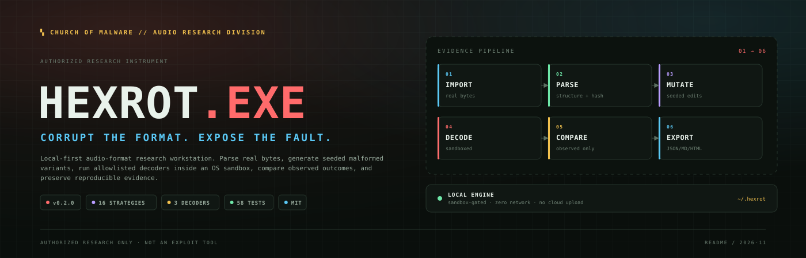
</div>

<div align="center">
  <a href="#quickstart"></a>
  <a href="#verification"></a>
  <a href="#quickstart"></a>
  <a href="#quickstart"></a>
  <a href="#decoders--isolation"></a>
  <a href="#license"></a>
  <a href="#security-model"></a>
  <a href="#known-limitations"></a>
</div>

> **HEXROT.EXE is not a malware-analysis appliance, an exploit generator, or a cloud service.**
> It reads actual files, records their binary structure and metadata, generates deterministic malformed variants, and compares real decoder process outcomes. A rejection, discrepancy, or crash is an **observation**, not proof of a vulnerability, memory corruption, code execution, or exploitability.

> [!WARNING]
> This checkout was verified on Linux x86_64 **without** `bubblewrap`, `ffmpeg`, or `sndfile-info`, so decoder execution and four sandbox integration tests were skipped. The macOS `sandbox-exec` profile is implemented but **unverified on Apple Silicon**; `sandbox-exec` is deprecated by Apple. Use a disposable Linux VM for genuinely high-risk files.

---

## 🟩 At a glance

| `0.2.0` | `56` | `50 / 6` | `16` | `3` | `15` | `7` |
|:--:|:--:|:--:|:--:|:--:|:--:|:--:|
| release | tests collected | passed / env-skipped | mutation strategies | decoder adapters | API endpoints | CI jobs configured |

| Plane | State in this checkout | What that means |
|---|---|---|
| 🟩 Backend core | **Verified** | `50 passed, 6 skipped` in about `1.4 s`; parsers, mutation, API, storage, reports exercised with real bytes |
| 🟩 Frontend | **Verified** | `tsc --noEmit` clean; Vite production build `1,053.79 kB` (`652.33 kB` gzip) |
| 🟦 Browser-only preview | **Implemented; not E2E-tested here** | Bounded RIFF/AIFF inspection in memory; no persistence, no mutation files, no decoder jobs |
| 🟨 Decoder execution | **Gated, not exercised here** | Requires a passing sandbox self-test plus an allowlisted decoder; both absent in this container |
| 🟨 Linux integration | **Code-complete, not run here** | Four sandbox tests skipped because `bubblewrap` is unavailable |
| 🟥 macOS / ARM64 | **Unverified** | Deny-by-default Seatbelt profile exists; no Mac was used in this revision |
| 🟨 CI matrix | **Configured, not observed here** | Workflow defines seven jobs; no CI run is claimed by this document |

### 🎨 How to read the color coding

| Swatch | Lane | Applies to |
|:--:|---|---|
| 🟩 | **Verified facts** | Source-backed behavior, tests, hashes, parsed fields, local build output |
| 🟦 | **Interface & flow** | Browser modules, API endpoints, quickstart, operations |
| 🟪 | **Transformation** | Architecture internals, mutation engine, data model |
| 🟨 | **Evidence & interpretation** | Differential findings, triage, exports, confidence, caveats |
| 🟥 | **Risk & execution** | Sandbox, guardrails, hard limits, threat model |

Diagrams use the same palette: **cyan** presentation, **green** verified local facts, **purple** deterministic transformation, **amber** evidence/interpretation, **red** execution/risk.

---

## 📚 Contents

| # | Section | # | Section |
|:--:|---|---|:--|
| 01 | [🟩 What it is — and is not](#what-it-is) | 09 | [🟦 API reference](#api-reference) |
| 02 | [🟦 Quickstart](#quickstart) | 10 | [🟥 Security, limits & threat model](#security-model) |
| 03 | [🟪 Architecture](#architecture) | 11 | [🟩 Verification & CI](#verification) |
| 04 | [🟦 The evidence pipeline](#workflow) | 12 | [🟦 Operations & troubleshooting](#operations) |
| 05 | [🟪 Mutation engine](#mutation) | 13 | [🟪 Repository map](#repository-map) |
| 06 | [🟥 Decoders & isolation](#decoders--isolation) | 14 | [🟪 Roadmap](#roadmap) |
| 07 | [🟨 Differential & triage](#differential--triage) | 15 | [🟨 Changelog](#changelog) |
| 08 | [🟨 Evidence exports](#evidence) | 16 | [🟩 Glossary & references](#glossary) |

<details>
<summary><strong>Documentation map — where each claim comes from</strong></summary>

| Document | Purpose |
|---|---|
| [`docs/architecture.md`](docs/architecture.md) | Layer responsibilities, isolation, API surface |
| [`docs/adapters.md`](docs/adapters.md) | Decoder adapter rules, evidence, adding a tool |
| [`docs/fixtures.md`](docs/fixtures.md) | Seven generated fixtures and expected observations |
| [`docs/audit-0.2.0.md`](docs/audit-0.2.0.md) | v0.2.0 engineering audit (historical) |
| [`docs/verification-0.1.1.md`](docs/verification-0.1.1.md) | v0.1.1 local verification (historical) |
| [`docs/roadmap.md`](docs/roadmap.md) | Engineering roadmap and non-goals |
| [`SECURITY.md`](SECURITY.md) | Threat model, isolation caveats, disclosure |
| [`CONTRIBUTING.md`](CONTRIBUTING.md) | Reproducibility and review requirements |
| [`docs/diagrams/`](docs/diagrams/) | Source and generator for every SVG in this README |

</details>

---

<a id="what-it-is"></a>
## 🟩 01 · What it is — and is not

### The design contract

1. **Real bytes only.** Parsing, hashing, mutation, and decoding operate on actual uploaded files. No fixture is substituted for a failed dependency.
2. **The original is immutable.** Every variant is written to a new UUID file; the original remains byte-identical and is retained for baseline comparison.
3. **Facts and interpretations are separate.** Raw chunk offsets, extracted metadata, and computed hashes are facts. URLs, path-like text, encoding anomalies, duplicate tags, and size anomalies are labeled **heuristics**.
4. **Execution is gated.** Decoder processes run only after an OS sandbox self-test passes, with fixed executables, fixed argument arrays, resource limits, and bounded output.
5. **Interpretation is conservative.** Acceptance, rejection, timeout, resource limit, signal termination, and infrastructure error are distinct outcomes.
6. **Local first.** No remote upload, telemetry endpoint, cloud key, or remote model call exists. The only upload target is the loopback API.

| ✅ HEXROT.EXE does | ⛔ HEXROT.EXE does not |
|---|---|
| Parse RIFF/WAVE, AIFF/AIFC, FLAC metadata blocks, MP3/ID3 structures | Claim exhaustive format validation |
| Compute SHA-256 over exact file bytes | Treat a hash as a trust verdict |
| Record chunk offsets, declared vs actual lengths, trailing bytes | Execute embedded media content |
| Extract RIFF INFO, AIFF text, ID3/Vorbis fields, artwork fingerprints | Open URLs or paths found in metadata |
| Generate seeded malformed variants with an edit ledger | Generate exploit payloads or weaponized files |
| Run allowlisted decoders inside an OS sandbox | Accept arbitrary commands or executable paths |
| Compare observed decoder acceptance, properties, hashes, repeats | Prove memory corruption or exploitability |
| Rerun signal terminations and preserve reproduction evidence | Auto-publish findings or assign CVEs |
| Export JSON, Markdown, and escaped HTML evidence | Upload files to a cloud service |

---

<a id="quickstart"></a>
## 🟦 02 · Quickstart

### Requirements

| Component | Minimum | Notes |
|---|---|---|
| Node.js | `20.19+` or `22.12+` | Vite 7 requirement; verified on `22.22.3` |
| Python | `3.11+` | `3.11.2` used for the recorded run; `3.12` recommended |
| FFmpeg | optional | `ffmpeg` + `ffprobe` enable decode/probe adapters |
| libsndfile | optional | `sndfile-info` enables the libsndfile adapter |
| bubblewrap | Linux, required for execution | `bwrap`; unprivileged user + network namespaces must work |
| `sandbox-exec` | macOS, required for execution | Deprecated by Apple; experimental profile |
| Chromium | optional | Only for `scripts/ui_e2e.mjs` |

### Apple Silicon macOS

```sh
brew install node python@3.12 ffmpeg libsndfile
python3.12 -m venv .venv
source .venv/bin/activate
python -m pip install -e '.[test]'
npm ci
python scripts/generate_fixtures.py
./scripts/run-local.sh
```

Open **<http://127.0.0.1:5173>** and press `Ctrl+C` to stop both services. The launcher refuses to start if `.venv` or `node_modules` is missing.

### Linux

```sh
sudo apt-get update
sudo apt-get install -y nodejs python3-venv bubblewrap ffmpeg libsndfile1 sndfile-programs
python3 -m venv .venv
source .venv/bin/activate
python -m pip install -e '.[test]'
npm ci
python scripts/generate_fixtures.py
./scripts/run-local.sh
```

> The Linux worker expects `bwrap` in `/usr/bin` or `/usr/local/bin` and `/usr/bin/python3` inside the sandbox. Unprivileged user and network namespaces must be permitted. System package directories stay readable; the host home does not. If the sandbox self-test fails, decoder execution stays disabled.

### Two-terminal alternative

```sh
# Terminal 1 — never bind this API to a public interface
source .venv/bin/activate
python -m uvicorn backend.main:app --host 127.0.0.1 --port 8000
```

```sh
# Terminal 2
npm run dev -- --host 127.0.0.1
```

### Environment variables

| Variable | Default | Consumed by | Effect |
|---|---|---|---|
| `HEXROT_HOME` | `~/.hexrot` | backend | Private workspace root for SQLite and UUID files |
| `VITE_HEXROT_API` | `http://127.0.0.1:8000/api` | frontend build/dev | API base URL, baked at build time |
| `HEXROT_UI` | `http://127.0.0.1:5173` | `scripts/ui_e2e.mjs` | UI base URL |
| `HEXROT_API` | `http://127.0.0.1:8000/api` | `scripts/ui_e2e.mjs` | API base URL for assertions |
| `CHROMIUM` | `/usr/bin/chromium` | `scripts/ui_e2e.mjs` | Chromium executable |

### Ports & binding

| Port | Service | Binding | Exposure |
|---:|---|---|---|
| `5173` | Vite dev server | `127.0.0.1` via `--host` | Loopback only |
| `8000` | FastAPI | `127.0.0.1` | Loopback only; host/origin guard |

Do **not** bind `uvicorn` to `0.0.0.0`, reverse-proxy it, or expose it through a tunnel. Browser-origin checks are not authentication.

### First-run checklist

- [ ] `GET /api/health` returns `{"status":"online","version":"0.2.0",...}`.
- [ ] `isolation.available` is `true` before expecting decoder jobs. `false` is a safe refusal, not a crash.
- [ ] **Load Sample** imports `tests/fixtures/reference.wav` with SHA-256 `7a854dbf8865aa2f82e9f39cde4e0af812b053ce1bee077442cbf346c7ed6f1a`.
- [ ] **Autopsy** shows `RIFF → fmt → LIST → data`, `8,000 Hz`, mono, `16-bit`, `0.25 s`.
- [ ] **Mutator** with seed `42` and count `5` produces five files plus the original.
- [ ] **Decoder Lab** lists all three allowlisted adapters, selects installed ones, and disables unavailable tools.
- [ ] **Evidence** exports JSON, Markdown, or HTML and the session reopens after a restart.

With the backend connected, **Import File** always creates a new session with your own authorized input, and **Load Sample** creates a demo session from the fixture. In browser-only mode both stay in memory.

> **Browser-only mode** starts automatically when the API is unreachable. It fetches the bundled `reference.wav`, parses a bounded RIFF/AIFF subset in memory, and disables mutation, decoder, triage, and persistent export. It does not inspect FLAC/MP3 deeply and creates no SQLite session.

---

<a id="architecture"></a>
## 🟪 03 · Architecture

<div align="center">
  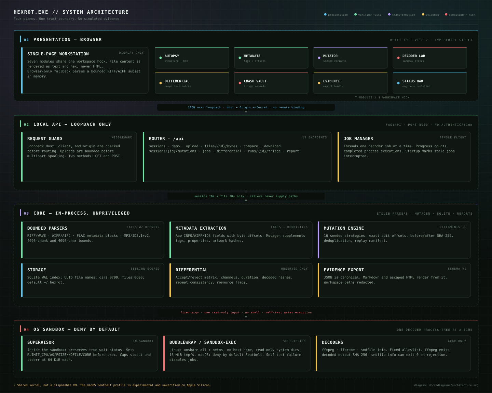
</div>

### Four planes, one trust boundary

| Plane | Components | Trust position | Can do | Cannot do |
|---|---|---|---|---|
| **01 Presentation** | React 19, Vite 7, seven modules | Untrusted display | Render text/hex, call loopback API, inspect a small subset in-browser | Read files directly, execute decoders, persist sessions in browser mode |
| **02 Local API** | FastAPI on loopback, request guard, job manager | Same user, no auth | Accept uploads, create sessions, start one job, export reports | Accept non-loopback hosts/origins, run concurrent jobs |
| **03 Core** | Stdlib parsers, Mutagen, mutation engine, SQLite, analysis, reports | Same user, unsandboxed | Parse bytes, extract tags, generate variants, persist evidence | Execute media content or reach the network |
| **04 Sandbox** | Supervisor + allowlisted decoders | Restricted worker | Execute one fixed decoder per process tree under rlimits | Reach the network/home, write outside `/tmp`, choose arbitrary argv |


### Stack

| Layer | Components | Version / role |
|---|---|---|
| Presentation | React, React DOM | `19.2.6` |
| Build | Vite, `@vitejs/plugin-react`, `vite-plugin-singlefile` | `7.3.7` / single-file production bundle |
| Language | TypeScript | `5.9.3`, strict |
| Styling | Tailwind CSS, `@tailwindcss/vite`, `clsx`, `tailwind-merge` | `4.1.17` |
| UI icons/fonts | `lucide-react`, IBM Plex Mono, Space Grotesk | Bundled locally |
| API | FastAPI, Pydantic, Uvicorn | `>=0.115`, `>=0.30` |
| Storage | Python `sqlite3` (WAL) | Standard library |
| Media metadata | Mutagen | `>=1.47` |
| Process sampling | psutil | `>=6` |
| Tests | pytest, httpx/TestClient, Playwright | `>=8`, `>=0.27`, `>=1.65` |

### Request lifecycle

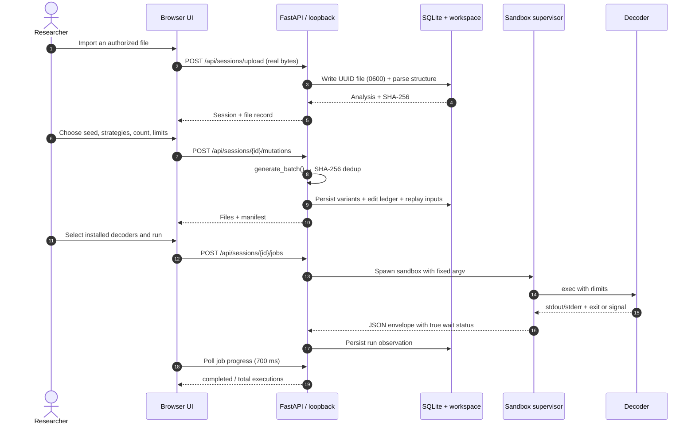

### Data model

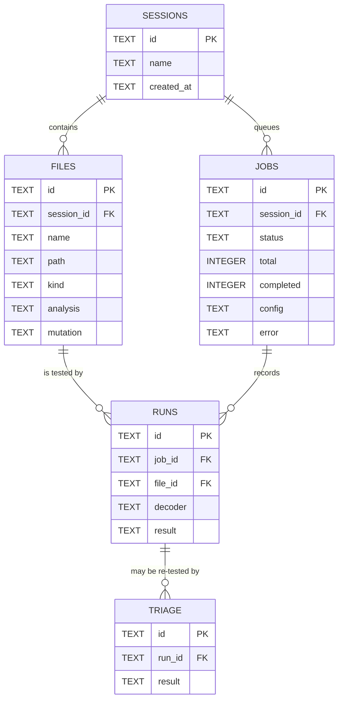

### Storage layout

```text
~/.hexrot/                          # HEXROT_HOME; created 0700
├── research.sqlite3                # WAL index: sessions, files, jobs, runs, triage
├── research.sqlite3-wal
├── research.sqlite3-shm
└── <session-uuid>/                 # 0700
    ├── <file-uuid>                 # 0600, raw bytes, name never used as a path
    ├── <file-uuid>
    └── ...
```

- API callers pass **session IDs and file IDs**, never filesystem paths.
- `clean_name()` strips directories, control characters, and length overruns.
- SQLite stores analysis and mutation records as JSON; raw bytes stay in UUID files.
- Reports replace the absolute workspace root with `<WORKSPACE>`.

### Why this shape

| Decision | Reason | Cost |
|---|---|---|
| Local SQLite over a server database | Single-user research workflow; zero network surface | No concurrent multi-user access |
| In-process parsers | Precise byte offsets and direct file reads | Malicious media may attack Python/Mutagen outside the sandbox |
| Decoder sandbox separate from backend | Limits blast radius of media decoders | Two isolation implementations to maintain |
| Fixed adapter allowlist | Removes command-injection and PATH-trust classes | Adding a tool requires source changes |
| JSON as canonical evidence | One schema renders all formats; easy to diff | Large bundles; no binary attachments |
| Browser fallback parser | Useful preview when backend is absent | Deliberately narrower than the real parser |

---

<a id="workflow"></a>
## 🟦 04 · The evidence pipeline

<div align="center">
  
</div>

### Reproducible workflow

| # | Stage | Action | Endpoint / UI | Artifact |
|:--:|---|---|---|---|
| 01 | **Import** | Load the generated fixture or an authorized file | `POST /api/sessions/upload` or **Import File** | Session + original file |
| 02 | **Autopsy** | Inspect hash, magic, chunk map, declared vs actual sizes | **Autopsy** | Analysis JSON |
| 03 | **Metadata** | Extract tags with offsets; review labeled heuristics | **Metadata** | Metadata fields + artwork hashes |
| 04 | **Mutate** | Generate seeded variants from the immutable original | `POST /api/sessions/{id}/mutations` | Variant files + edit ledger |
| 05 | **Decode** | Run allowlisted tools inside the gated sandbox | `POST /api/sessions/{id}/jobs` | Runs with exit/signal, logs, limits |
| 06 | **Compare** | Inspect acceptance matrix and repeated-run consistency | `GET /api/sessions/{id}/differential` | Findings per file |
| 07 | **Triage** | Rerun a real signal termination, test the original, drop edits | `POST /api/sessions/{id}/runs/{run_id}/triage` | Reproduction record |
| 08 | **Export** | Preserve and reopen the session | `GET /api/sessions/{id}/report?format=...` | JSON / Markdown / HTML |

### The canonical demo path

```text
Import reference.wav
  → SHA-256 7a854dbf…ed6f1a
  → RIFF (container), fmt (PCM 8 kHz mono 16-bit), LIST/INFO, data (0.25 s)
  → seed 42, count 5, default strategy cycle
  → 5 variants: header_boundary, chunk_length, truncation, signature, trailing
  → select installed decoders (ffmpeg, ffprobe, sndfile-info)
  → job total = 6 files × N decoders × repeats
  → differential matrix + logs
  → export JSON/MD/HTML
```


<details>
<summary><strong>The seven deterministic fixtures</strong></summary>

| Fixture | Expected observation |
|---|---|
| `reference.wav` | RIFF/WAVE, `fmt `, `LIST/INFO`, `data`; 8 kHz mono PCM, 0.25 s, three INFO fields, no parser warning |
| `reference.aiff` | FORM/AIFF with `COMM`, `NAME`, `SSND`; 8 kHz mono PCM, 0.25 s |
| `inconsistent_length.wav` | Data chunk declares 512 more bytes than are available |
| `truncated.wav` | Container and data chunk extend past the shortened file |
| `extension_mismatch.mp3` | RIFF/WAVE magic with an `.mp3` extension |
| `duplicate_info.wav` | Two `INAM` INFO fields; duplicate-metadata heuristic |
| `trailing_bytes.wav` | 21 bytes following the declared RIFF container |

All contain harmless synthesized PCM or text. Expectations are asserted by `tests/unit/test_parsers.py`. See [`docs/fixtures.md`](docs/fixtures.md).

</details>

### Workflow guarantees

| Guarantee | Implementation |
|---|---|
| Original never modified | Variants are separate UUID files; baseline uses the original |
| Same inputs produce same bytes | `random.Random(f"{seed}:{index}:{strategy}")` + deterministic edit order |
| Every edit is inspectable | Offset, old/new length, 128-byte preview, before/after SHA-256 |
| Unsupported strategy fails loudly | `MutationError` → HTTP `422`, never a silent no-op |
| Cancel is real | Cancel event + `SIGKILL` to the active process group; job status `canceled` |
| Progress is not simulated | `completed / total` counts persisted decoder executions |

### Screenshots

<div align="center">
  
  <br/>
  <sub><strong>File Autopsy</strong> — real fixture, four parsed regions, selected <code>fmt</code> highlighted in the hex viewer. Capture is from a recorded build; the header version label shown there predates the 0.2.0 source correction.</sub>
</div>

<div align="center">
  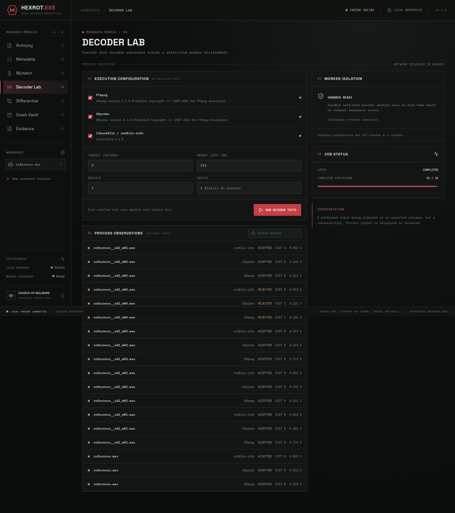
  <br/>
  <sub><strong>Decoder Lab</strong> — sandbox self-test passed, three adapters, <code>18 / 18</code> real executions, and per-file accepted/rejected outcomes with captured stderr.</sub>
</div>

<div align="center">
  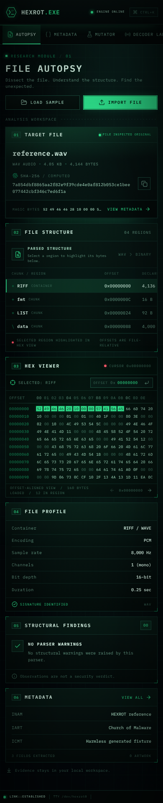
  <br/>
  <sub><strong>Responsive layout</strong> — 390 px viewport; modules become a horizontal rail.</sub>
</div>

---

<a id="mutation"></a>
## 🟪 05 · Mutation engine

The engine applies **seeded, bounded byte edits to a copy** of the original. It does not append exploit payloads, run fuzzers, or mutate the stored original.

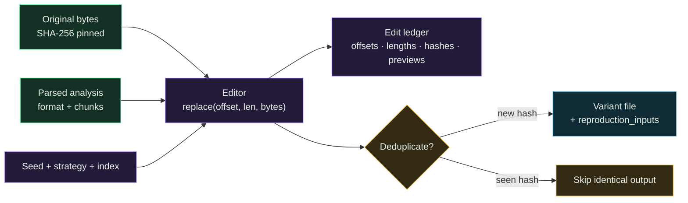

### Strategy matrix

| Strategy | Gate | Field / operation | Purpose |
|---|---|---|---|
| `header_boundary` | WAV/AIFF/FLAC/MP3 | Container or tag size → `0`, `1`, `0xFFFFFFFF`, max block/syncsafe | Header boundary handling |
| `chunk_length` | WAV/AIFF/FLAC | Chunk/block declared size → maximum | Declared-vs-actual divergence |
| `truncation` | any | Cut the tail by up to ~⅓ of file length | Short-read and truncated-container handling |
| `duplicate_metadata` | WAV with `LIST/INFO` | Duplicate the first INFO field; fix RIFF/LIST sizes | Duplicate-tag heuristics |
| `metadata_value` | WAV with `LIST/INFO` | Replace first field value with empty or `A × N` (bounded) | Empty/oversized metadata |
| `invalid_encoding` | MP3 with ID3v2 text frame | Set text-encoding marker to `0xFF` | Invalid encoding handling |
| `signature` | any | Replace first up to 4 bytes with `XROT` | Container-signature mismatch |
| `trailing` | any | Append 24 seeded bytes | Bytes outside declared container |
| `chunk_order` | any with ≥2 adjacent chunks | Swap the first two adjacent chunks | Order-dependent parsing |
| `seeded_bytes` | any with chunks | Flip one seeded bit in a selected region | Region-targeted bit flip |
| `boundary_min` | WAV/AIFF/FLAC | Chunk or block size → `0` | Zero-length structure |
| `boundary_max` | WAV/AIFF/AIFC | Container size → `4 × file length` (capped) | Oversized declared container |
| `boundary_off_by_one` | WAV/AIFF/AIFC | Chunk size → `actual ± 1` | Off-by-one length handling |
| `zero_length_field` | WAV `fmt` / MP3 ID3 | `fmt` chunk size or ID3 tag size → `0` | Zero-length declared field |
| `max_syncsafe` | MP3 with ID3v2 | Tag size → `0x0FFFFFFF` | Max valid syncsafe integer |
| `negative_duration` | WAV `fmt` / AIFF `COMM` | Sample rate or frame count → `0` | Impossible/undefined duration |

Default cycle: `header_boundary → chunk_length → truncation → signature → trailing`.

### Determinism & replay

```python
rng = random.Random(f"{seed}:{index}:{strategy}")
```

Every history record contains:

```json
{
  "strategy": "chunk_length",
  "seed": 42,
  "index": 1,
  "region": "any",
  "size_limit": 33554432,
  "metadata_size": 8192,
  "edits": [
    {
      "offset": 40,
      "old_length": 4,
      "new_length": 4,
      "before_hex": "64000000",
      "after_hex": "ffffffff",
      "before_sha256": "…",
      "after_sha256": "…",
      "preview_truncated": false,
      "description": "Inflate data declared chunk size"
    }
  ],
  "original_sha256": "…",
  "original_size": 4144,
  "sha256": "…",
  "result_size": 4144,
  "format": "WAV",
  "reproducible": true,
  "reproduction_inputs": {
    "seed": 42,
    "strategy": "chunk_length",
    "index": 1,
    "region": "any",
    "size_limit": 33554432,
    "metadata_size": 8192,
    "original_sha256": "…"
  }
}
```

### Batch semantics

| Rule | Behavior |
|---|---|
| Count | `1…50` variants per request |
| Strategy cycling | `strategies[index % len(strategies)]` |
| Dedup | Default `true`; skips outputs identical to the original or any earlier output |
| Return count | Always attempts `count` generations; may return fewer after dedup or unsupported combinations |
| Size limit | Variant may not exceed `max_file_size` (≤ 32 MiB) |
| Metadata limit | `metadata_size` is `0…65,536` bytes |
| Region filter | Only `seeded_bytes` uses a named chunk/region |
| Failure mode | Unsupported format/strategy returns `MutationError`; API returns `422` |

### Manifest returned by the API

```json
{
  "session_id": "…",
  "seed": 42,
  "count_requested": 5,
  "count_generated": 5,
  "deduplicated": true,
  "strategies": ["header_boundary", "chunk_length", "truncation", "signature", "trailing"],
  "max_file_size": 33554432,
  "metadata_size": 8192,
  "region": "any",
  "original_sha256": "…",
  "output_hashes": ["…", "…", "…", "…", "…"]
}
```

### Intentional limits

- The edit preview is **128 bytes**; large edits are represented by full output bytes plus before/after SHA-256. Triage refuses lossy replay when any preview was truncated.
- Four strategies require a RIFF `LIST/INFO`; one requires an ID3v2 text frame. Unsupported input returns an error instead of a misleading success.
- The engine performs **no** structure-aware repair: malformed is the point.
- Mutation does not imply a decoder will crash. Most malformed inputs are rejected cleanly.

---

<a id="decoders--isolation"></a>
## 🟥 06 · Decoders & isolation

### Compatibility matrix

| Adapter | Actual operation | Output evidence | Availability | Important caveat |
|---|---|---|---|---|
| **FFmpeg** | Decodes first audio stream with `-f hash -hash sha256` | Exit/signal, bounded stderr, decoded-stream SHA-256 | Optional `ffmpeg` | Uses FFmpeg libraries; not independent from ffprobe |
| **ffprobe** | Reads stream/format properties as JSON | Exit/signal, bounded JSON, channels, sample rate, duration | Optional `ffprobe` | Acceptance is process exit; fields may be absent |
| **libsndfile** | Runs `sndfile-info` on the input | Exit/signal, bounded text, channels, sample rate, duration | Optional `sndfile-info` | Inspector only; no decoded-output hash; can exit `0` on failure |

> FFmpeg and ffprobe are **not independent decoder implementations**. A disagreement between them is evidence of a parser/reporting difference, not two independent confirmations. `sndfile-info` inspects headers and does not produce a comparable decoded-output hash.

### The gate

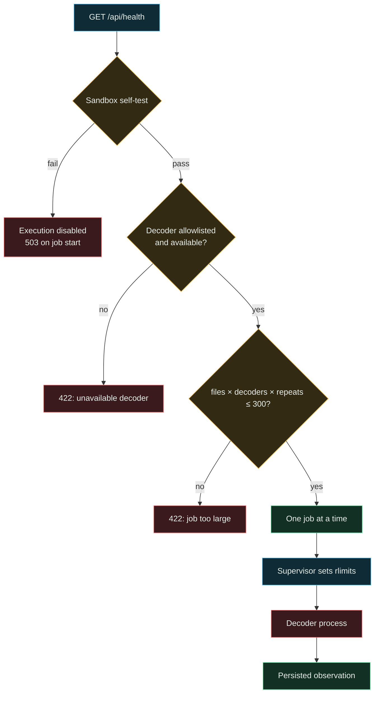

### Isolation comparison

| Control | Linux — bubblewrap | macOS — `sandbox-exec` |
|---|---|---|
| Namespaces | `--unshare-all`, explicit user + network namespaces | Seatbelt profile, no namespaces |
| Network | Network namespace, loopback unreachable | No network permission granted |
| Host home | Not mounted | Not granted by profile |
| System reads | Read-only `/usr`, `/lib`, `/lib64`, `/bin`, loader links | `/usr`, `/System`, `/dev/null`, `/dev/random`, `/dev/urandom` |
| Input | One read-only bind at `/input/audio` | Literal path read grant |
| Writes | 16 MiB private tmpfs at `/tmp` | `/dev/null` only |
| Processes | `--die-with-parent`, `--new-session`; no nested user namespaces | `process-fork` not granted globally; interpreter + decoder exec only |
| Environment | `--clearenv`; `PATH` and `HOME` only | Inherited launch environment, profile-restricted |
| Self-test | `bwrap … /usr/bin/true` | `sandbox-exec … /usr/bin/true` |
| Verification | **Not exercised here** | **Not verified on Apple Silicon** |

<div align="center">
  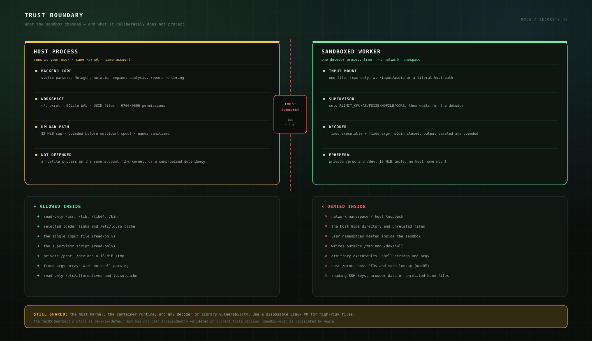
</div>

### Resource controls

| Control | Enforced value | Kind |
|---|---|---|
| Wall-clock timeout | `0.25–30 s` (default `5 s`) | Sampled loop + `SIGKILL` process group |
| Address space | `128–2048 MB` (default `512 MB`) | `RLIMIT_AS` |
| CPU seconds | `ceil(timeout) + 1` | `RLIMIT_CPU` |
| File size | `1 MiB` | `RLIMIT_FSIZE` |
| Open files | `64` | `RLIMIT_NOFILE` |
| Core dumps | `0` | `RLIMIT_CORE` |
| Process count | `512` per real UID | `RLIMIT_NPROC` |
| Process tree | `32` processes | 20 ms sampled monitor |
| Memory/CPU tree | `resource_exceeded` at limit; differential flags >80% RSS | Sampled, not cgroup quota |
| Output | `64 KiB` stdout + `64 KiB` stderr | Supervisor buffers |
| Concurrency | `1` job | `JobManager` lock |

Limits are applied by the **in-sandbox supervisor before exec**, not through Python `preexec_fn` in API worker threads (which can deadlock with threads). Sampling is monitoring, not enforcement: `RLIMIT_*` values are hard per process, while aggregate RSS/CPU tree checks can miss peaks between polls.

### Why signal status matters

A shell reports a signal-killed child as exit code `139`. That does **not** prove `SIGSEGV`. HEXROT.EXE runs a supervisor **inside** the sandbox so `waitpid` preserves the true status:

```json
{"returncode": -11, "stdout": "...", "stderr": "...", "stdout_truncated": false, "stderr_truncated": false}
```

The host records `abnormal: true`, `signal: 11`, and keeps `exit_code: -11`. A normal nonzero exit, timeout, cancellation, resource-limit signal, or sandbox infrastructure error is classified separately.

---

<a id="differential--triage"></a>
## 🟨 07 · Differential & triage

### What the comparison actually checks

| Signal | Classification | Meaning |
|---|---|---|
| One decoder accepts, another rejects | `Parser discrepancy` | Observed parser divergence; not a vulnerability |
| All decoders reject | `Expected rejection` | A malformed file was rejected; this is a normal outcome |
| Accepted decoders report different channels | `Parser discrepancy` | Reported property divergence |
| Accepted decoders report different durations (> 1 ms) | `Parser discrepancy` | Reported duration divergence |
| Accepted decoders produce different decoded hashes | `Parser discrepancy` | Decoded output divergence |
| Timeout, resource flag, or RSS > 80% of limit | `Resource anomaly` | Resource pressure, not exploitability |
| Signal termination | `Unconfirmed security concern` | Needs triage; still not proof of exploitability |
| Signal termination reproduced twice | `Reproducible crash` | Repeatable observation, not a CVE |
| Repeated runs differ for the same decoder | `Parser discrepancy` | Non-deterministic or stateful behavior |

### Job lifecycle

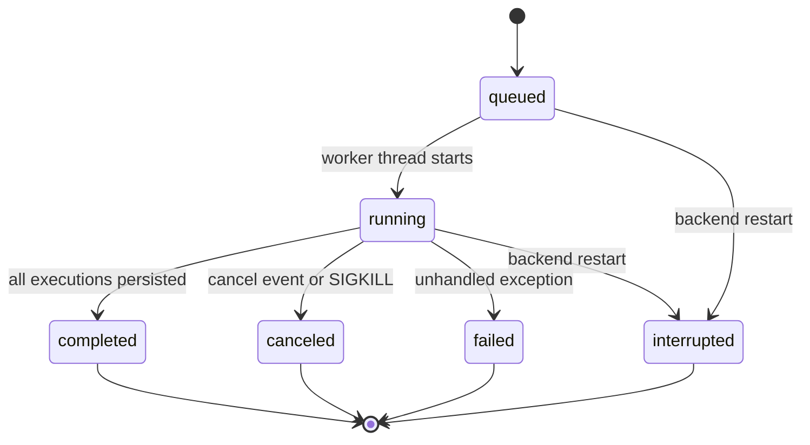

On startup, any `queued` or `running` job from a previous process is marked `interrupted` with a recorded error. Progress is `completed / total`; cancel sets the event and kills the active process group.

### Crash triage flow

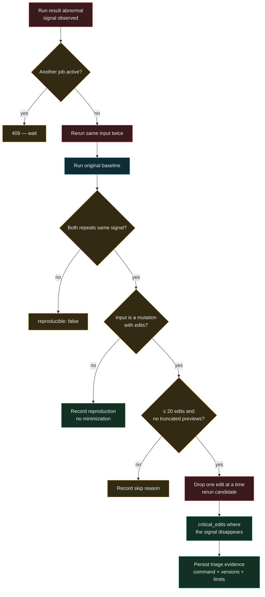

### Current triage record

| Field | Meaning |
|---|---|
| `reproducible` | Both reruns are abnormal with the **same observed signal** |
| `original_run` | The full original observation, including invocation and limits |
| `repeats` | Two fresh executions of the same file/decoder/limits |
| `baseline` | Execution of the unchanged original |
| `mutation` | Edit ledger copied from the variant |
| `reproduction` / `reproduction_command` | Input path redacted to `<INPUT>`; shell-joined display |
| `minimization` | Bounded `single_edit_drop` result, or a documented skip |
| `decoder_version`, `exit_status`, `signal` | Tool and termination provenance |
| `resource_exceeded`, `is_resource_limit` | Distinguishes limit termination from a parser signal |
| `note` | Explicit “observation, not proof” warning |

> **Delta-drop scope (0.2.0 / current revision):** at most 20 edits, one edit dropped per candidate, and no replay when any edit preview exceeded 128 bytes. It is **not** full `ddmin`, does not explore subsets, and does not produce debugger stack traces or exploitability analysis. A “critical” edit is a candidate contributor, not a root cause.

### Reading the verdict ladder

| Level | Evidence | Permitted claim |
|:--:|---|---|
| 1 | File parsed; warnings recorded | “The parser observed X at offset Y.” |
| 2 | Decoder rejects malformed input | “This decoder rejected the input.” |
| 3 | Decoders disagree | “Observed parser discrepancy under these versions and limits.” |
| 4 | Signal termination | “The decoder terminated by signal N in this environment.” |
| 5 | Signal reproduced twice | “The signal is reproducible with this input and limits.” |
| 6 | Edit removal changes outcome | “This edit is a contributing candidate.” |
| — | Anything beyond | **Not asserted by this tool.** |

---

<a id="evidence"></a>
## 🟨 08 · Evidence exports

### Formats

| Format | Content | Best for | Notes |
|---|---|---|---|
| **JSON** | Canonical `hexrot-evidence-v1` bundle | Machine analysis, archival, diffing | Most complete; includes configs, edits, logs, triage, environment |
| **Markdown** | Narrative report rendered from JSON | Review, issue comments, lab notes | Includes file facts, warnings, metadata, observations, findings |
| **HTML** | Self-contained escaped report | Sharing a readable snapshot | Markdown is HTML-escaped inside `<pre>`; no active content |

Every export sets `Content-Disposition: attachment; filename="hexrot-evidence.<format>"`.

### Bundle schema

```text
hexrot-evidence-v1
├── schema
├── exported_at
├── session                 {id, name, created_at}
├── environment             {platform, architecture, python, isolation, decoders}
├── files[]                 {id, name, kind, analysis, mutation}
│   ├── analysis            format, size, sha256, magic, facts, chunks,
│   │                       metadata, artwork, warnings, heuristics
│   └── mutation            strategy, seed, index, edits, reproduction_inputs
├── jobs[]                  {id, status, total, completed, config, error}
├── runs[]                  {decoder, result{exit, signal, accepted, logs, limits}}
├── differential[]          {file_id, filename, findings[], runs[]}
├── triage[]                {run_id, reproducible, repeats, baseline, minimization}
├── confidence              {process_observations, security_interpretation}
└── limitations[]           explicit scope reminders
```

### Redaction & privacy

| Item | Included in export? | Note |
|---|---|---|
| File bytes | No | Only hashes, sizes, parsed facts, metadata text |
| Host workspace path | Redacted | Replaced with `<WORKSPACE>` |
| Sandbox input path | Redacted | `<INPUT>` in invocation/reproduction |
| Metadata from the file | **Yes** | It is evidence; may contain sensitive strings |
| Decoder stderr | **Yes, bounded** | May echo paths or input content |
| Tool versions | Yes | Reproducibility provenance |
| Absolute system paths | Sometimes | Invocation may include executable locations |

Review exports before sharing. A report can contain hostile metadata, URLs, or private strings copied from the input.

### Reopening

Sessions live in SQLite under `HEXROT_HOME`. Restarting the API does not lose files, jobs, runs, or triage. The UI remembers the last session in `localStorage`, falling back to the newest session; if none exists it creates a demo session from the fixture.

---

<a id="api-reference"></a>
## 🟦 09 · API reference

Base URL: `http://127.0.0.1:8000/api`. All responses are JSON unless a file/report is returned.

### Endpoints

| # | Method | Path | Purpose | Key input | Errors |
|:--:|---|---|---|---|---|
| 1 | `GET` | `/health` | Status, version, isolation, decoders, limits | — | — |
| 2 | `GET` | `/sessions` | List up to 100 sessions | — | — |
| 3 | `POST` | `/sessions/demo` | Create a session from `tests/fixtures/reference.wav` | — | `503` fixture missing |
| 4 | `POST` | `/sessions/upload` | Upload a real file (multipart `file`) | ≤ 32 MiB | `400` empty, `413` oversize |
| 5 | `GET` | `/sessions/{sid}` | Session + files + jobs + runs + triage | — | `404` |
| 6 | `GET` | `/sessions/{sid}/files/{fid}/bytes` | Base64 bytes at offset | `offset ≥ 0`, `length 1–4096` | `404`, `422` |
| 7 | `GET` | `/sessions/{sid}/files/{fid}/compare` | Offset-aligned original vs variant | `offset`, `length` | `404` |
| 8 | `GET` | `/sessions/{sid}/files/{fid}/download` | Raw file download | — | `404` |
| 9 | `POST` | `/sessions/{sid}/mutations` | Generate seeded variants | `count`, `seed`, `strategies`, limits | `422` unknown strategy/size |
| 10 | `POST` | `/sessions/{sid}/jobs` | Start one decoder job | `file_ids`, `decoders`, `timeout_seconds`, `memory_mb`, `repeats` | `409`, `422`, `503` |
| 11 | `GET` | `/jobs/{job_id}` | Job status + active worker PID | — | `404` |
| 12 | `POST` | `/jobs/{job_id}/cancel` | Cancel the active job | — | `404`, `409` |
| 13 | `GET` | `/sessions/{sid}/differential` | Comparison matrix | — | `404` |
| 14 | `POST` | `/sessions/{sid}/runs/{run_id}/triage` | Reproduce and minimize | — | `404`, `409`, `422` |
| 15 | `GET` | `/sessions/{sid}/report` | Evidence export | `format=json\|md\|html` | `404`, `422` |

### Request models

<details>
<summary><code>MutationRequest</code> defaults & bounds</summary>

| Field | Default | Bounds |
|---|---|---|
| `count` | `5` | `1–50` |
| `seed` | `42` | `0–2³²−1` |
| `strategies` | 5-strategy default cycle | `1–16` names, all in `STRATEGIES` |
| `max_file_size` | `33,554,432` | `1–33,554,432` |
| `metadata_size` | `8192` | `0–65,536` |
| `region` | `any` | string ≤ 100 chars; used by `seeded_bytes` |
| `deduplicate` | `true` | boolean |

</details>

<details>
<summary><code>JobRequest</code> defaults & bounds</summary>

| Field | Default | Bounds |
|---|---|---|
| `file_ids` | all session files | ≤ 51 IDs, de-duplicated |
| `decoders` | `["ffmpeg","ffprobe"]` | `1–3` installed allowlisted IDs |
| `timeout_seconds` | `5` | `0.25–30` |
| `memory_mb` | `512` | `128–2048` |
| `repeats` | `1` | `1–5` |
| Job size | — | `files × decoders × repeats ≤ 300` |

</details>

### Examples

```sh
# Health and inventory
curl -s http://127.0.0.1:8000/api/health | python -m json.tool

# Create the genuine fixture session
curl -s -X POST http://127.0.0.1:8000/api/sessions/demo | python -m json.tool

# Upload an authorized file
curl -s -X POST http://127.0.0.1:8000/api/sessions/upload \
  -F "file=@tests/fixtures/reference.wav" | python -m json.tool

# Generate five deterministic variants
curl -s -X POST "http://127.0.0.1:8000/api/sessions/<SID>/mutations" \
  -H 'Content-Type: application/json' \
  -d '{"count":5,"seed":42,"strategies":["header_boundary","chunk_length","truncation","signature","trailing"],"deduplicate":true}' \
  | python -m json.tool

# Run installed decoders (requires a passing sandbox self-test)
curl -s -X POST "http://127.0.0.1:8000/api/sessions/<SID>/jobs" \
  -H 'Content-Type: application/json' \
  -d '{"decoders":["ffmpeg"],"timeout_seconds":5,"memory_mb":512,"repeats":1}' \
  | python -m json.tool

# Export evidence
curl -s "http://127.0.0.1:8000/api/sessions/<SID>/report?format=md" -o evidence.md
```

### Network guard

| Check | Accepted | Rejected |
|---|---|---|
| `Host` header | `127.0.0.1`, `localhost`, `[::1]`, empty, `testserver` | Anything else → `403` |
| Client address | `127.0.0.1`, `::1`, `testclient` | Anything else → `403` |
| Browser `Origin` | `http(s)://localhost\|127.0.0.1\|[::1]` with optional port | Anything else → `403` |
| CORS methods | `GET`, `POST` | Other methods |
| CORS credentials | Disabled | — |
| Request body | ≤ 1 MiB non-upload; ≤ 33 MiB upload | `413` |

The service has **no authentication**. It assumes a trusted local user and does not defend against a hostile process already running as that user.

---

<a id="security-model"></a>
## 🟥 10 · Security, limits & threat model

<div align="center">
  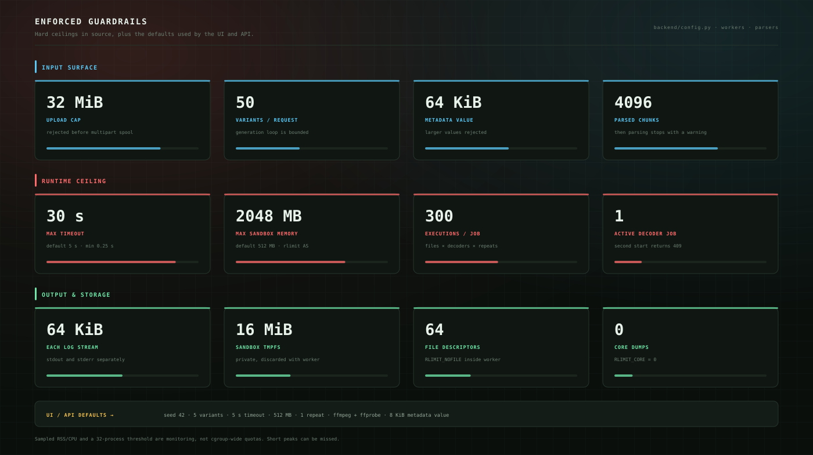
</div>

### Threat model

| In scope | Out of scope |
|---|---|
| Untrusted file bytes and metadata in parsers | A hostile process already running as the same host user |
| Malicious media reaching allowlisted decoders | Kernel-level sandbox escapes |
| Command injection via filenames, decoder arguments, or strategy names | Remote multi-user access or authentication |
| Path traversal and workspace escape | Denial of service against the host machine |
| Origin/host confusion against the loopback API | Supply-chain compromise of Python/npm dependencies |
| Unbounded output, time, memory, or file growth | Exfiltration by this application (no upload client or telemetry) |
| Accidental export of local workspace paths | A decoder that reports false data or a user who misreads an observation |
| — | Content safety of metadata or decoder logs |

### Unsandboxed by design

These components run in the backend process, **outside** the decoder sandbox:

- RIFF/WAVE, AIFF/AIFC, FLAC, and MP3/ID3 parsing (Python standard library)
- Mutagen metadata/tag extraction
- Mutation generation
- SQLite storage and report rendering
- `psutil` process sampling on the host

A malicious media file can therefore attempt to exploit the parser or a dependency. The decoder sandbox limits decoder blast radius, not parser blast radius. Use a disposable VM for high-risk material.

### Guardrail table

| Category | Ceiling | Enforcement |
|---|---|---|
| Upload | `32 MiB` | Streamed read + middleware |
| Variants | `50` per request | Pydantic bound + generator loop |
| Metadata value | `64 KiB` | Mutation validation |
| Parsed chunks | `4,096` | Parser loop guard |
| Metadata text | `4,096` chars | Extraction truncation |
| Mutagen values | `50` per key | Extraction slice |
| Mutagen tag items | `500` | Tag iteration slice |
| Diff log stream | `64 KiB` each | Supervisor buffer |
| Sandbox tmpfs | `16 MiB` | `bwrap --tmpfs` |
| File descriptors | `64` | `RLIMIT_NOFILE` |
| Core dumps | `0` | `RLIMIT_CORE` |
| Execution timeout | `30 s` max | API bound + supervisor clock |
| Sandbox memory | `2,048 MB` max | API bound + `RLIMIT_AS` |
| Executions per job | `300` | API precondition |
| Concurrent jobs | `1` | `JobManager` lock |
| Sessions listed | `100` | SQL `LIMIT` |

### Known limitations

- **macOS/ARM64 execution is unverified.** `sandbox-exec` is deprecated; the Seatbelt profile may need adjustment or may be unavailable on a given release. A basic self-test is not a security audit.
- **Parsers are not exhaustive.** MP3 frame-level validation, ID3 extended headers/unsynchronization, FLAC audio-frame verification, full artwork parsing, and every malformed encoding variant are not implemented.
- **Mutagen may fail on damaged files.** Its failure is recorded as a warning; raw parser facts remain authoritative.
- **Metadata mutations are format-specific.** Duplicate/empty/oversized values target RIFF INFO; invalid encodings target ID3 text frames. Unsupported combinations return an error.
- **Triage is bounded.** No full `ddmin`, no debugger stack traces, no exploitability analysis, max 20 edits, and no lossy replay when a preview exceeded 128 bytes. Dropping a length-changing edit can shift later stored offsets, so candidate reconstruction is approximate.
- **Browser-only mode is narrow.** It supports a bounded RIFF/AIFF subset, creates no persisted session, and does not run decoders.
- **One decoder job at a time.** Sampled CPU/RSS values are approximate; short peaks can be missed and are not cgroup quotas.
- **ffprobe acceptance is exit-based.** A zero exit with missing fields is still recorded as accepted, with absent properties showing as `null`.
- **`sndfile-info` is an inspector.** It produces no decoded-output hash and may exit `0` on failure; the adapter inspects text before recording acceptance.
- **Linux assumptions.** `bwrap` must resolve from a fixed directory and `/usr/bin/python3` must exist inside the sandbox.
- **Historical evidence is historical.** `docs/pytest-output.txt` and `docs/ui-e2e-output.json` describe earlier builds, not this checkout.

Report suspected issues privately via the repository's security advisory mechanism. See [`SECURITY.md`](SECURITY.md) for disclosure guidance. Do not publish a working exploit or unrelated private data.

---

<a id="verification"></a>
## 🟩 11 · Verification & CI

<div align="center">
  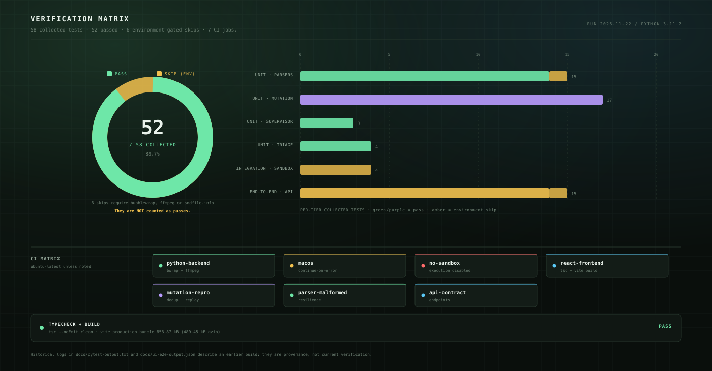
</div>

### Local run — 2026-11-19

| Property | Value |
|---|---|
| Platform | Linux x86_64 (container) |
| Python | `3.11.2` (project supports `≥3.11`) |
| Node / npm | `22.22.3` / `10.9.8` |
| Sandbox | unavailable (`bubblewrap` not installed) |
| Decoders | unavailable (`ffmpeg`, `sndfile-info` not installed) |

```console
$ python -m pytest -q
50 passed, 6 skipped, 1 warning in 1.43s
```

```console
$ npm run typecheck
> tsc --noEmit
# clean

$ npm run build
vite v7.3.7 building client environment for production...
✓ 2146 modules transformed.
dist/index.html  1,053.79 kB │ gzip: 652.33 kB
✓ built in 4.36s
```

### Test tiers

| Tier | Collected | Passed | Skipped | Covers |
|---|---:|---:|---:|---|
| `tests/unit` — parsers | 15 | 14 | 1 | Real fixture structure/hash, malformed inputs, FLAC/MP3 metadata (ffmpeg-gated) |
| `tests/unit` — mutation | 17 | 17 | 0 | Determinism, exact offsets, all strategies, dedup, replay inputs, original preservation |
| `tests/unit` — supervisor | 3 | 3 | 0 | Real child execution, exit status, inherited rlimits |
| `tests/unit` — triage | 4 | 4 | 0 | Observed-signal comparison, critical-edit direction, lossy-preview guard, edit cap |
| `tests/integration` — sandbox | 4 | 0 | 4 | Decoder output hash, signal vs exit, host home/loopback denial, sndfile zero-exit |
| `tests/end_to_end` — API | 13 | 12 | 1 | Full workflow, path safety, origin policy, limits, manifests, dedup, reports, cancel |
| **Total** | **56** | **50** | **6** | |

### The six skips

| Test | Requires | Why it is skipped here |
|---|---|---|
| `test_generated_flac_and_mp3_metadata` | `ffmpeg` | Encoded fixtures cannot be generated |
| `test_decoder_real_results_and_output_hash` | `bubblewrap` + `ffmpeg` | No sandbox, no decoder |
| `test_supervisor_distinguishes_signal_and_exit_code` | `bubblewrap` | Sandbox unavailable |
| `test_no_host_home_or_host_loopback_access` | `bubblewrap` | Sandbox unavailable |
| `test_sndfile_info_zero_exit_can_still_mean_rejection` | `sndfile-info` | Tool not installed |
| `test_cancel_stops_actual_decoder_worker` | `bubblewrap` + `ffmpeg` | No sandbox, no decoder |

> **Skips are not passes.** They are environment-gated by design and must be re-run on a machine with the required tools before claiming decoder or isolation verification.

### CI matrix (configured)

| Job | Runner | What it does | Status here |
|---|---|---|---|
| `python-backend` | ubuntu-latest | Installs bubblewrap + ffmpeg, runs unit/integration/e2e | Configured, not observed |
| `python-backend-macos` | macos-latest | Unit + integration with `continue-on-error` | Configured, not observed |
| `python-backend-no-sandbox` | ubuntu-latest | Asserts execution is disabled without a sandbox | Configured, not observed |
| `react-frontend` | ubuntu-latest | `npm ci`, typecheck, production build | Configured, not observed |
| `mutation-reproducibility` | ubuntu-latest | Determinism, replay, dedup filters | Configured, not observed |
| `parser-malformed-inputs` | ubuntu-latest | Empty/truncated/oversized/garbage inputs | Configured, not observed |
| `api-contract` | ubuntu-latest | Health, manifest, dedup, boundary strategies | Configured, not observed |

### Browser end-to-end (optional, not run here)

With both services running, Chromium installed, and a disposable workspace:

```sh
HEXROT_HOME=/path/to/disposable/workspace node scripts/ui_e2e.mjs
```

The script imports the real fixture, generates five variants, compares bytes, runs available isolated decoders, exports a report, reopens the session, and cancels an active worker. It writes the three screenshots used above.

### Reproduce the verification

```sh
python scripts/generate_fixtures.py
python -m pytest -q
npx tsc --noEmit
npm run build
python docs/diagrams/generate_diagrams.py   # deterministic SVG regeneration
```

---

<a id="operations"></a>
## 🟦 12 · Operations & troubleshooting

### Health checks

```sh
curl -s http://127.0.0.1:8000/api/health | python -m json.tool
curl -s http://127.0.0.1:8000/api/sessions | python -m json.tool
```

`health.isolation.available` must be `true` before decoder execution. `health.decoders[].available` reflects fixed-path executable discovery and version probing.

### Troubleshooting

| Symptom | Likely cause | Fix |
|---|---|---|
| `503 Decoder execution disabled: …` | Sandbox self-test failed or sandbox absent | Install/repair `bubblewrap`; on macOS verify `sandbox-exec`; read the reason string |
| `422 A selected decoder is unavailable or not allowlisted` | Tool not installed or not in fixed paths | Install into `/usr/bin`, `/usr/local/bin`, `/opt/homebrew/bin`, or `/opt/local/bin` |
| `409 Another decoder job is already running` | Single-job lock | Wait or cancel the active job |
| `409 Job is not running` on cancel | Job already finished | Refresh job status |
| `413 Request exceeds the configured size limit` | Upload > 32 MiB or JSON body > 1 MiB | Reduce input or request |
| `400 Empty files are not accepted` | Zero-byte upload | Provide a real file |
| `422 Unknown strategies: [...]` | Strategy name typo or version mismatch | Use the names in `STRATEGIES` / the UI list |
| `503 Fixture missing` on demo | Fixtures not generated | `python scripts/generate_fixtures.py` |
| Backend banner: “Backend unavailable” | API not running, wrong port, or blocked origin | Start uvicorn on `127.0.0.1:8000`; do not use a non-local host |
| Decoder returns `UNKNOWN` | `sndfile-info` output did not include channels/rate | Inspect raw stdout/stderr; ambiguous output is intentionally not “accepted” |
| No decoded-output hash | `ffprobe` / `sndfile-info` do not decode | Use FFmpeg for a decoded-stream SHA-256 |
| UI E2E: Chromium missing | Default `/usr/bin/chromium` absent | `CHROMIUM=/path/to/chromium node scripts/ui_e2e.mjs` |
| UI E2E: no active worker observed | Decoders too fast / not available | Ensure bubblewrap + ffmpeg and repeats > 1 |
| `npm ci` fails | Registry or lockfile mismatch | Use Node `20.19+`/`22.12+`; do not modify the lockfile casually |
| Decoder “REJECTED” looks like a failure | Malformed input was rejected | This is an expected observation, not a tool error |

### Reset a workspace

```sh
# Destructive: removes sessions, variants, and evidence for this HEXROT_HOME only.
rm -rf "${HEXROT_HOME:-$HOME/.hexrot}"
```

Never point `HEXROT_HOME` at a directory containing unrelated files.

### Performance notes

| Operation | Typical behavior |
|---|---|
| Parse a 4 KiB fixture | Milliseconds |
| Generate 5 variants | Milliseconds |
| Poll a decoder job | Every `700 ms` from the UI |
| Health polling | Every `15 s` while connected |
| API request timeout | `8 s` (upload `60 s`, triage `120 s`) |
| Typical decoder run | Hundreds of milliseconds; bounded by timeout |

### Adding a decoder or strategy

- **Decoder:** follow [`docs/adapters.md`](docs/adapters.md). Add a fixed ID, fixed executable, version probe, argv builder, bounded interpreter, and real-fixture tests. Update the compatibility matrix.
- **Strategy:** add to `STRATEGIES`, keep it reproducible from `(original, seed, strategy, index, region, limits)`, record exact offsets/hashes, and test applicability failures. Update the strategy matrix and [`CONTRIBUTING.md`](CONTRIBUTING.md) if the contract changes.

---

<a id="repository-map"></a>
## 🟪 13 · Repository map

```text
HEXROT.EXE/
├── backend/
│   ├── main.py                 # FastAPI app, 15 routes, guards, triage orchestration
│   ├── config.py               # MAX_FILE_SIZE, MAX_MUTATIONS, MAX_METADATA_VALUE, MAX_LOG, HEXROT_HOME
│   ├── parsers/audio.py        # Bounded RIFF/WAVE, AIFF/AIFC, FLAC, MP3/ID3 parsers
│   ├── metadata/inspection.py  # Raw text extraction, Mutagen supplementation, labeled heuristics
│   ├── mutation/engine.py      # Editor, 16 strategies, batch dedup, replay manifest
│   ├── storage/database.py     # SQLite WAL index + UUID workspace
│   ├── decoders/adapters.py    # Fixed allowlist, argv builders, output interpreters, acceptance
│   ├── workers/isolation.py    # bubblewrap / sandbox-exec commands + self-test
│   ├── workers/supervisor.py   # In-sandbox rlimits + true wait status + bounded logs
│   ├── workers/runner.py       # Host-side process control, sampling, result schema
│   ├── workers/jobs.py         # Single active job, progress, cancel, restart recovery
│   ├── analysis/differential.py# Observed-only comparison and findings
│   └── reports/export.py       # Canonical JSON bundle + Markdown/HTML rendering
├── src/
│   ├── App.tsx                 # Seven-module shell + status bar
│   ├── components/             # Chrome (nav/topbar) + HexViewer
│   ├── hooks/useWorkspace.ts   # Backend/browser mode, polling, actions
│   ├── pages/                  # Autopsy, Metadata, Mutator, DecoderLab,
│   │                           # Differential, CrashVault, Evidence
│   ├── services/api.ts         # Loopback API client + formatting helpers
│   ├── services/browserAnalysis.ts # Deliberately small in-browser parser
│   ├── types/index.ts          # Shared frontend types
│   └── index.css               # Dark research-console design system
├── tests/
│   ├── unit/                   # Parsers, mutation, supervisor, triage
│   ├── integration/            # Sandbox + real decoder execution
│   ├── end_to_end/             # API workflow and contracts
│   └── fixtures/               # Seven deterministic synthetic audio files
├── scripts/
│   ├── generate_fixtures.py    # Deterministic 8 kHz mono PCM fixtures
│   ├── run-local.sh            # API + Vite launcher, loopback only
│   └── ui_e2e.mjs              # Playwright browser workflow
├── docs/
│   ├── diagrams/               # SVG sources + deterministic generator
│   ├── screenshots/            # Recorded UI captures
│   ├── architecture.md         # Layer/isolation/API narrative
│   ├── adapters.md             # Decoder adapter contract
│   ├── fixtures.md             # Fixture expectations
│   ├── audit-0.2.0.md          # Engineering audit
│   ├── verification-0.1.1.md   # Historical verification
│   └── roadmap.md              # Roadmap and non-goals
├── public/fixtures/reference.wav # Browser-only demo fixture
├── .github/workflows/verify.yml  # Seven-job CI matrix
├── pyproject.toml              # Python package + pytest configuration
├── package.json                # React/Vite/Tailwind frontend
└── SECURITY.md, CONTRIBUTING.md, LICENSE
```

### Where to change what

| Goal | Files |
|---|---|
| Add a mutation strategy | `backend/mutation/engine.py`, `tests/unit/test_mutation.py`, README strategy table |
| Add a decoder | `backend/decoders/adapters.py`, `backend/workers/isolation.py`, `tests/integration/test_sandbox.py` |
| Change API limits | `backend/config.py`, `backend/main.py` Pydantic models, tests, README guardrails |
| Change the UI | `src/pages/*`, `src/components/*`, `src/index.css` |
| Change evidence schema | `backend/reports/export.py`, `tests/end_to_end/test_workflow.py` |
| Regenerate diagrams | `docs/diagrams/generate_diagrams.py` |
| Change CI | `.github/workflows/verify.yml` |

---

<a id="roadmap"></a>
## 🟪 14 · Roadmap

### Shipped in 0.2.0

- Six boundary-value mutation strategies and format-aware chunk-level testing.
- SHA-256 deduplication during batch generation.
- Structured reproduction manifests for every variant.
- Bounded single-edit-drop triage (corrected in this revision to use the observed signal and refuse lossy replay).
- Tighter macOS Seatbelt profile: no global `process-fork`, writes limited to `/dev/null`, explicit executable/input/supervisor allowlist.
- 12 malformed-input parser tests and a seven-job CI matrix.

### Next

| Priority | Work | Why |
|---|---|---|
| P0 | Validate the macOS profile on Apple Silicon; record a current run | The profile is unverified and `sandbox-exec` is deprecated |
| P0 | Exercise Linux bubblewrap + FFmpeg integration in CI with retained logs | Six tests are skipped in this checkout |
| P1 | Add Playwright E2E to CI with dependency checks | Browser workflow is only script-verified |
| P1 | Implement true bounded `ddmin` over edit subsets | Current triage is single-edit-drop only |
| P2 | Deeper MP3 frame and FLAC frame inspection | Parser coverage is structure-level |
| P2 | cgroup/container resource enforcement | Sampled RSS/CPU is approximate |
| P2 | Additional sandboxed decoders (SoX, reference FLAC, mpg123) | Improve independent comparison |
| P3 | HTML report formatting beyond escaped Markdown | Current HTML is a safe readable snapshot |

### Explicit non-goals

- Cloud upload, remote analysis, or telemetry.
- Exploit payload generation, automatic exploitation, or weaponization.
- Multi-user authentication or public binding of the loopback API.
- Migrating the local SQLite workflow to PostgreSQL.
- Claiming a CVE or exploitability from an observation.

---

<a id="changelog"></a>
## 🟨 15 · Changelog

### Documentation revision — 2026-11-19 (working tree)

- Rebuilt this README with color-coded sections, a diagram suite, charts, an API reference, guardrail tables, and an explicit evidence-claim ladder.
- Added `docs/diagrams/generate_diagrams.py` and six deterministic SVGs (hero, architecture, workflow, trust boundary, verification, guardrails).
- **Fixed triage correctness:** single-edit-drop analysis now compares candidates against the **observed run signal** instead of a missing mutation field that made every edit appear critical.
- Added a lossy-replay guard: triage refuses to rebuild candidates when any edit preview was truncated at 128 bytes.
- Added four regression tests (`tests/unit/test_triage.py`); current total is **56 collected / 50 passed / 6 skipped**.
- Corrected the AIFF `negative_duration` edit to zero `numSampleFrames` at the true COMM body offset (`+2`, after channels), with fixture coverage.
- Corrected the frontend header version label from `v0.1.1` to `v0.2.0`.

### 0.2.0

- Added six boundary-value strategies: `boundary_min`, `boundary_max`, `boundary_off_by_one`, `zero_length_field`, `max_syncsafe`, `negative_duration`.
- Added SHA-256 deduplication to batch mutation generation.
- Every mutation records a structured `reproduction_inputs` manifest.
- Added bounded delta debugging to crash triage.
- Tightened the macOS `sandbox-exec` profile; added 12 malformed-input parser tests.
- Expanded CI to seven jobs and bumped API/frontend to 0.2.0.

### 0.1.1

- Moved decoder resource limits into the sandbox supervisor, avoiding `preexec_fn` in worker threads.
- Added regression tests for real child execution, exit status, and inherited limits.
- Added the one-command local launcher and deterministic fixtures.
- Strengthened `.gitignore`, naming, documentation links, and lockfile metadata.
- Removed the bundled virtual environment and build caches from the upload archive.

### Version matrix

| Component | Version |
|---|---|
| Python package / API | `0.2.0` |
| npm package / UI | `0.2.0` |
| Evidence schema | `hexrot-evidence-v1` |
| Mutation engine | 16 strategies |
| Decoder adapters | 3 |

---

<a id="glossary"></a>
## 🟩 16 · Glossary & references

| Term | Meaning here |
|---|---|
| **Autopsy** | Static inspection of container structure, chunks, metadata, and warnings |
| **Variant / mutation** | A new file produced by seeded edits to a copy of the original |
| **Edit ledger** | Ordered offsets, lengths, previews, and byte hashes for each change |
| **Deduplication** | Skipping a variant whose SHA-256 matches the original or an earlier variant |
| **Acceptance** | The decoder's process-level outcome, interpreted per adapter (not “file is valid”) |
| **Differential** | A comparison of observed outcomes across files, decoders, or repeats |
| **Signal termination** | The process was killed by a signal; true value comes from `waitpid` inside the sandbox |
| **Reproducible crash** | The same signal observed in both triage reruns with the same input/limits |
| **Resource anomaly** | Timeout, limit flag, or sampled usage near the configured ceiling |
| **Single-edit-drop** | Triage method that removes one edit at a time to find contributing candidates |
| **Evidence bundle** | Canonical JSON plus rendered Markdown/HTML for a session |
| **Isolation self-test** | A harmless probe that must pass before any decoder job starts |
| **Heuristic** | A labeled interpretation (URL, path, encoding, duplicate tag), not a security finding |

### References

- [Mutagen documentation](https://mutagen.readthedocs.io/en/latest/)
- [bubblewrap manual](https://manpages.debian.org/unstable/bubblewrap/bwrap.1.en.html)
- [Homebrew libsndfile](https://formulae.brew.sh/formula/libsndfile)
- Local `man sandbox-exec` on macOS (deprecated by Apple)
- [Vite 7](https://vite.dev/) · [React 19](https://react.dev/) · [FastAPI](https://fastapi.tiangolo.com/)

### Project documents

- [`SECURITY.md`](SECURITY.md) — threat model, isolation caveats, disclosure
- [`CONTRIBUTING.md`](CONTRIBUTING.md) — reproducibility and review rules
- [`docs/architecture.md`](docs/architecture.md) — layer and isolation narrative
- [`docs/adapters.md`](docs/adapters.md) — decoder adapter contract
- [`docs/fixtures.md`](docs/fixtures.md) — fixture expectations and hashes
- [`docs/roadmap.md`](docs/roadmap.md) — priorities and non-goals
- [`docs/diagrams/README.md`](docs/diagrams/README.md) — diagram palette and regeneration

---

<a id="license"></a>
## License

MIT — see [`LICENSE`](LICENSE).

<div align="center">
  <sub><strong>CHURCH OF MALWARE</strong> · AUDIO RESEARCH DIVISION<br/>
  Authorized research only. Corrupt the format. Expose the fault.</sub>
</div>
