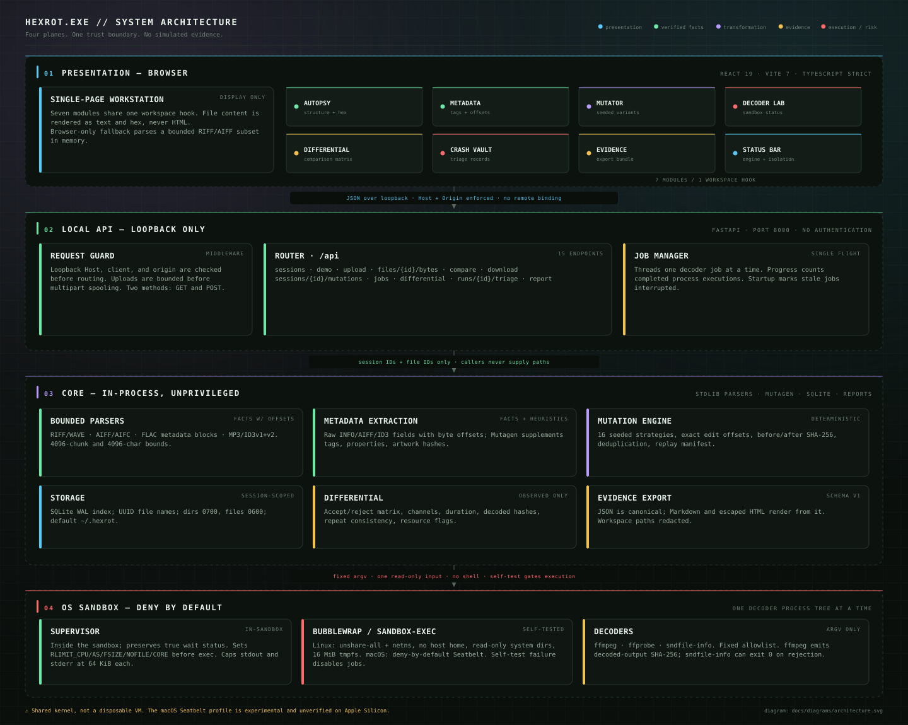
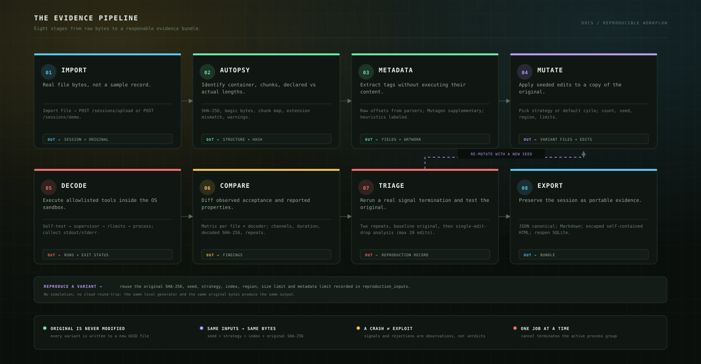

# Architecture

React/Vite communicates with a loopback FastAPI service. A session owns a UUID-addressed original, generated variants, SQLite records, decoder jobs, process observations, differential findings, and triage records. The frontend's browser-only parser is deliberately smaller and does not claim backend capabilities.

1. `backend/parsers` reads bounded RIFF/WAVE, AIFF/AIFC, FLAC metadata-block, and MP3/ID3 structures. `backend/metadata` supplements those facts with Mutagen and labeled heuristics.
2. `backend/mutation` applies seeded edits to a copy of the original and records offsets in edit order, before/after lengths, previews, and SHA-256 fingerprints. Large edits are fully represented by the generated file and fingerprints, not embedded in SQLite.
3. `backend/storage` owns private workspace paths and the SQLite index. API callers provide IDs rather than filesystem paths.
4. `backend/decoders` maps fixed adapter IDs to fixed executable names and argument arrays. No input field supplies a command or executable path.
5. `backend/workers` gates execution on an OS sandbox self-test, applies rlimits, and supervises one decoder job at a time. A small supervisor inside the sandbox preserves the decoder's true signal status: an exit code of 139 is not assumed to be SIGSEGV.
6. `backend/analysis` compares recorded observations, and `backend/reports` exports a sanitized evidence bundle. Triage reruns a signal termination and performs bounded single-edit-drop analysis (max 20 edits; no lossy replay when a preview exceeded 128 bytes).

## Isolation

Linux bubblewrap uses `--unshare-all`, an explicit network and user namespace, disabled nested user namespaces, read-only `/usr`, `/lib`, `/lib64`, `/bin`, selected loader links, a read-only input and supervisor, a private `/proc` and `/dev`, and a size-limited `/tmp`. It does not bind the user's home. System package directories remain readable. A self-test failure disables decoder jobs. Tests also check that a host-loopback listener and a private host file cannot be reached from the sandbox.

macOS uses a generated deny-by-default Seatbelt profile with `sandbox-exec`. It permits system/package-manager reads, the supervisor and the single input, and execution of only the interpreter and selected adapter. Network is not allowed. This profile has not been exercised on macOS/ARM64 here, and `sandbox-exec` is deprecated. Use a disposable VM for stronger separation.

There is no application-level upload size cap: multipart data is spooled to disk, copied in bounded-memory chunks, and parsed through a read-only file mapping; available storage and parser/runtime resources still constrain practical file size. A 50-variant request cap, 64 KiB metadata-value cap, 64 KiB per log stream, 16 MiB Linux tmpfs, 64 file descriptors, no core dumps, a 512-task per-UID rlimit, address-space/CPU/file-size rlimits, and wall-clock timeout are enforced. A 32-process tree threshold, tree RSS, and CPU are sampled, not kernel-wide aggregate quotas, so short spikes may be missed. Static parsing and Mutagen run in the unsandboxed backend. See `SECURITY.md` and the [trust-boundary diagram](diagrams/trust-boundary.svg) for the trust boundary.

## API

All 16 endpoints are under `/api`. `GET /health` reports dependency and sandbox status. Upload via `POST /sessions/upload`, create the genuine fixture session via `POST /sessions/demo`, inspect `/sessions/{id}`, generate `/sessions/{id}/mutations`, start `/sessions/{id}/jobs`, poll or cancel `/jobs/{id}`, and read `/sessions/{id}/differential` or `/sessions/{id}/report?format=json|md|html`. File bytes, comparisons, range-based playback streams, and downloads use session/file IDs. The API accepts only local browser origins and is not an authenticated remote service.
